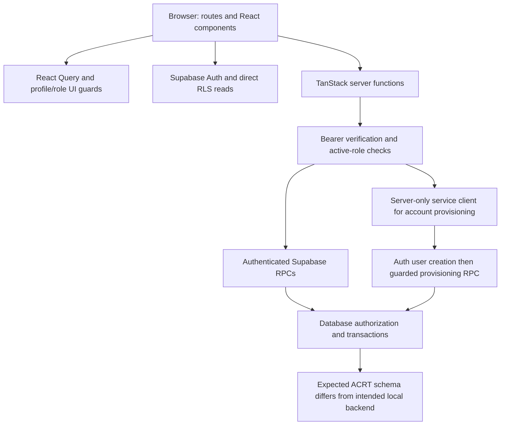

# M00 — Avanthi CRT Portal repository and architecture audit

**Date:** 10 October 2026 (Asia/Calcutta). **Development repository:** `D:\1.AVNT\ACRT`.
**Baseline:** `main` at `c0d508f28f941b868f8c3ce9f2ccfdfa91b974f2`, matching `origin/main` when inspected.
**Remote:** <https://github.com/ramesh28kore/acrt>.

## Decision and scope

ACRT contains a TanStack Start application with account-management dashboards. Its intended running local backend contains a substantially larger, incompatible LMS schema. The owner confirmed that `avanthi-portal` is the same intended project and selected **keep ACRT as the development repository and reconcile its backend**. This supersedes the earlier answer to treat Docker as a separate project.

Docker labels identify `D:\1.AVNT\CRT` as that backend's working directory. A read-only look at that folder found a separate Next.js application manifest, declaring Next 16.3.0, Monaco and Supabase SSR. This is useful recovery evidence, not permission to replace ACRT or proof that the sibling application's features work. The sibling application's full code, Git state and deployment were not audited. No source was copied between folders.

Two evidence scopes must remain distinct throughout this report:

- **R — repository:** ACRT source and all three committed migrations, executed against isolated synthetic PostgreSQL. Findings in this scope do not automatically describe the running backend.
- **L — local backend:** read-only PostgreSQL catalog metadata from `supabase_db_avanthi-portal`. No account records, passwords, student submissions or other application data were read. No application RPCs were invoked against it.

The repository expects `user_roles`, `audit_logs` and `profiles.is_active`; the running database instead has `profiles.role`, `profiles.is_super_admin`, `profiles.is_disabled` and `audit_log`. Local browser and server URLs both resolve to `http://127.0.0.1:54321`, where that backend is running. **The current source/backend pairing is incompatible. Do not apply ACRT's initial migration to this populated schema as a repair.** Its `CREATE TABLE` statements conflict with existing tables, and its role model needs an explicit mapping.

The audit inspected source routes, administration components, server functions, auth modules, SQL, configuration, tests and documentation. Generic UI primitives were inventoried rather than individually reviewed for all accessibility/security properties. Hosted Supabase, provider settings and deployed production behavior remain unverified. There was no deployment, migration, account provisioning or GitHub write.

### Evidence and verification ledger

| ID  | Evidence                                                                                                                       | What it verifies and its limit                                                                                                                   |
| --- | ------------------------------------------------------------------------------------------------------------------------------ | ------------------------------------------------------------------------------------------------------------------------------------------------ |
| V1  | [Checks and baseline](audit-evidence/m00-2026-10-10-checks.json)                                                               | Git baseline, versions, local checks and GitHub results. The original untracked `package-lock.json` is preserved.                                |
| V2  | [Isolated policy results](audit-evidence/m00-2026-10-10-rls.json), [reproduction](audit-evidence/m00-2026-10-10-reproduce.mjs) | R: four-table schema, policies/functions, nine additional expectations; six fail. Synthetic auth roles/UIDs, not live Supabase JWT verification. |
| V3  | [Dependency audit](audit-evidence/m00-2026-10-10-dependencies.json)                                                            | Registry advisory results for the committed Bun lockfile; reachability requires separate assessment.                                             |
| V4  | [Local backend metadata](audit-evidence/m00-2026-10-10-local-backend.json)                                                     | L: 45 tables, 92 policies, 68 functions, 52 migration records, grants, triggers and selected authorization definitions. No application rows.     |
| V5  | [GitHub Actions run 38055189711](https://github.com/ramesh28kore/acrt/actions/runs/38055189711)                                | Exact audited commit: typecheck/test/build pass; lint/dependency audit fail. API inspection found main unprotected and no repository rulesets.   |

The initial working tree had only `?? package-lock.json`; 141 files were tracked. This audit adds documentation/evidence and updates documentation links and stale status text. Application code, migrations and dependency files are unchanged. Temporary audit tools were installed outside the repository.

## A. Verified technology stack

Versions below are locked/resolved in ACRT, checked against the installed packages. Manifest ranges alone were not treated as installed versions. Evidence: [package manifest](../package.json), [Bun lockfile](../bun.lock), [Vite configuration](../vite.config.ts), [TypeScript configuration](../tsconfig.json), V1.

| Layer                 | Verified version / state                                                          | Architectural implication and repeat check                                                                                         |
| --------------------- | --------------------------------------------------------------------------------- | ---------------------------------------------------------------------------------------------------------------------------------- |
| Runtime / installer   | Node 24.19.0; Bun 1.4.2 in CI and audit tool                                      | Repeat runtime versions and frozen Bun install. Bun is not assumed globally available on this machine.                             |
| Application framework | TanStack Start 1.168.60; Router 1.170.41; router plugin 1.168.42                  | File routes and TanStack server functions, not Next.js Server Actions. Inspect `src/routes` and function exports.                  |
| React                 | React and React DOM 19.2.8                                                        | Client rendering and shared component system.                                                                                      |
| TypeScript            | 5.9.3                                                                             | Strict checks, including unchecked indexing and exact optional properties; `skipLibCheck` enabled, unused-local checking disabled. |
| Styling               | Tailwind CSS 4.3.3; Radix/shadcn-style components                                 | Vite-integrated styling. No completed accessibility audit.                                                                         |
| Client data           | TanStack React Query 5.101.4                                                      | Profile and dashboard caching; server authorization must remain independent of cache.                                              |
| Supabase              | `@supabase/supabase-js` 2.117.3                                                   | Browser session storage and bearer-authenticated server functions. `@supabase/ssr` absent in ACRT.                                 |
| Build                 | Vite 8.1.5; Nitro 3.0.260603-beta; Lovable preset 2.25.3; Rolldown override 1.2.1 | Verified build emits a Cloudflare module Worker. Do not assume Vercel output.                                                      |
| Database tooling      | Drizzle ORM 0.45.4, Kit 0.31.11, postgres client 3.4.9                            | SQL migrations contain the schema; Drizzle TypeScript schema is empty.                                                             |
| Tests                 | Vitest 4.1.11; Testing Library React 16.3.3; jsdom 20.0.3                         | Component/contract tests with mocked server calls.                                                                                 |
| Other                 | Zod 3.25.76; Recharts 2.15.4                                                      | Input/output contracts and generic chart support; dependency presence does not establish academic analytics.                       |
| Isolated audit DB     | PGlite 0.3.14, PostgreSQL 17.5                                                    | Temporary audit tool; not a project dependency or live Supabase substitute.                                                        |
| Intended local DB     | PostgreSQL 17.6; PostgREST container v14.16; GoTrue v2.195.0                      | L only. Generated ACRT types mention PostgREST 14.18, which is not proof of the runtime version.                                   |
| Absent from ACRT      | Next.js, Supabase SSR, Monaco, XLSX, Python importer/runtime                      | Described in planning documents or present in the sibling manifest, but not implemented in ACRT.                                   |

No Vercel SDK/configuration establishes an ACRT deployment integration. Hosted database versions and provider deployment versions were not queried.

## B. Current application architecture



The router creates a QueryClient and loads generated file routes (`src/router.tsx:5`, `src/routeTree.gen.ts`). The root provides query context, metadata and error handling. The pathless authenticated layout disables SSR for protected routes and checks user/profile state (`src/routes/_authenticated/route.tsx:12`). `src/lib/me.ts:20` fetches profile/roles directly, prioritizing super admin, admin, faculty, student; its `['me']` cache is stale after 60 seconds.

`src/start.ts` applies CSRF protection to server functions and the auth attacher. `auth-attacher.ts` adds the session access token; `auth-middleware.ts` verifies claims and derives the actor from `sub`. Administration services check current active role again. Route guards are a user-experience layer; database/API checks provide enforcement.

The browser client persists sessions using the preview-storage adapter/localStorage. Server services use a separate service client only for privileged provisioning/administration paths. For account creation, Auth creates a confirmed user with a supplied password; migration 0001 creates a disabled, roleless profile; a guarded RPC assigns access. If provisioning fails, code attempts Auth-user deletion. This crosses Auth and database transactions, so failure compensation needs live integration coverage.

Major modules: `admin.contracts.ts` and `super-admin.contracts.ts` validate inputs/results; matching `.functions.ts` files expose handlers; `.server.ts` files implement services. Admin and Super Admin have separate component trees. `AppShell.tsx` hosts Student/Faculty placeholders. `error-capture.ts`, `error-page.ts`, `lovable-error-reporting.ts` and `server.ts` handle failures. `cron-auth.ts` exists but no active route consumes it. No repository code-execution service, importer or academic engine was found.

**Verification:** trace a handler through middleware, service, RPC and final migration policy; run V1 tests/build. After reconciliation, repeat with real role sessions and malformed/missing tokens. Build success alone does not verify a backend connection.

## C. Route, server-function and database inventory

### Routes in ACRT

| URL            | File under `src/routes/`         | Actual behavior / impact                                                                                              | Verification                                                         |
| -------------- | -------------------------------- | --------------------------------------------------------------------------------------------------------------------- | -------------------------------------------------------------------- |
| `/`            | `index.tsx`                      | Starter page and remote placeholder image; no portal landing/role redirect                                            | Inspect component; browser smoke check still required.               |
| `/auth`        | `auth.tsx`                       | Password login, active-profile check, self-reported sign-in log; sends recovery email request without completion flow | Inspect lines 24–58; integration-test recovery after backend repair. |
| `/dashboard`   | `_authenticated/dashboard.tsx`   | Redirects by primary role; no-role fallback                                                                           | Existing routing test plus real sessions later.                      |
| `/student`     | `_authenticated/student.tsx`     | Profile/shell and Coming Soon cards                                                                                   | No course, test or coding workflow implemented here.                 |
| `/faculty`     | `_authenticated/faculty.tsx`     | Shell and Coming Soon cards                                                                                           | No assigned-class/student workflow implemented here.                 |
| `/admin`       | `_authenticated/admin.tsx`       | Institute-scoped account overview, directory and activity                                                             | Component tests plus `scripts/verify-admin.mjs`.                     |
| `/super-admin` | `_authenticated/super-admin.tsx` | Global account/institute/role overview and activity                                                                   | Component tests plus `scripts/verify-super-admin.mjs`.               |

`__root.tsx` and `_authenticated/route.tsx` are layouts, not additional URLs. `routeTree.gen.ts` is generated. No conventional Next API route handlers or Next Server Actions exist in this repository.

| TanStack server function                                   | Method | Authorization and destination                                                            |
| ---------------------------------------------------------- | ------ | ---------------------------------------------------------------------------------------- |
| `adminOverview`, `adminUsers`, `adminActivity`             | GET    | Verified user, active institute admin; corresponding `admin_dashboard_*` RPC             |
| `adminUpdateUser`, `adminCreateUser`                       | POST   | Strict input, verified actor; server-only `admin_save_user`, Auth admin API for creation |
| `dashboardOverview`, `dashboardUsers`, `dashboardActivity` | GET    | Verified active super admin; corresponding `super_admin_*` RPC                           |
| `dashboardUpdateUser`                                      | POST   | Super admin, authenticated `super_admin_update_user`                                     |
| `dashboardCreateUser`                                      | POST   | Super admin, server Auth creation plus authenticated provisioning RPC                    |
| `dashboardSaveInstitute`                                   | POST   | Super admin, `super_admin_save_institute`                                                |

These 11 functions use generated TanStack server-function transport under `/_serverFn/`, not stable hand-authored REST endpoints. Evidence: `src/lib/admin.functions.ts`, `src/lib/super-admin.functions.ts` and the generated production artifact.

### R: database defined by ACRT

Migrations are [0000](../drizzle/migrations/0000_migration.sql), [0001](../drizzle/migrations/0001_super_admin_dashboard.sql), [0002](../drizzle/migrations/0002_admin_dashboard.sql). The journal lists all three. All four tables have RLS; V2 records 12 final policies and 16 functions.

| Table        | Columns / relationships                                                                                                   | Role in the product                                                                  |
| ------------ | ------------------------------------------------------------------------------------------------------------------------- | ------------------------------------------------------------------------------------ |
| `institutes` | UUID PK, unique code, name, created_at; seeds PT and Q6                                                                   | Campus identity only                                                                 |
| `profiles`   | Auth-user FK/PK with cascade, email, full_name, roll_number, institute FK, is_active, created_at, updated_at, disabled_at | User state; no classes/enrollment                                                    |
| `user_roles` | UUID PK, Auth-user FK with cascade, app_role, unique(user_id, role)                                                       | Four-value enum: student/faculty/admin/super_admin                                   |
| `audit_logs` | UUID PK, actor_id, target_id, institute_id, action, details JSONB, created_at                                             | Management events and portal-reported sign-ins; UUID references have no foreign keys |

The database permits multiple roles per user, while management RPCs replace all roles with one selected role. This is a contract decision to preserve or revise explicitly during reconciliation. Do not silently flatten the intended backend's independent super-admin/module permissions.

| Function group  | Names                                                                                                                        | Boundary                                                                                             |
| --------------- | ---------------------------------------------------------------------------------------------------------------------------- | ---------------------------------------------------------------------------------------------------- |
| Super Admin (5) | `super_admin_overview`, `super_admin_users`, `super_admin_activity`, `super_admin_update_user`, `super_admin_save_institute` | Authenticated execute, active super-admin check inside                                               |
| Admin (4)       | `admin_dashboard_overview`, `admin_dashboard_users`, `admin_dashboard_activity`, `admin_save_user`                           | Reads derive current institute; mutation executable only by service_role and rechecks verified actor |
| Helpers (4)     | `has_role`, `user_institute`, `assert_super_admin`, `admin_institute`                                                        | Anonymous execute revoked; first two still accept arbitrary target UUIDs from authenticated users    |
| Triggers (3)    | `protect_profile_columns`, `handle_new_user`, `stamp_login_audit`                                                            | Protected profile edits, disabled provisioning, stamped sign-in metadata                             |

All 16 final functions pin an empty search path. Fifteen use SECURITY DEFINER; `protect_profile_columns` uses SECURITY INVOKER. Mutations share an advisory transaction lock, fresh authorization and atomic profile/role/audit writes. Indexed fields include profile institute and audit timestamp/institute. Query plans and larger-scale performance were not measured.

`drizzle/schema.ts` is empty and its initial snapshot has no tables; do not infer that Drizzle generation represents these SQL migrations. Generated Supabase types omit `disabled_at` and new RPCs; services compensate with local types/casts. `supabase/config.toml` contains only a project ID. There is no tracked, complete Supabase local setup or first-super-admin bootstrap procedure.

### L: intended running backend inventory

Catalog snapshot V4 records **45 public tables, all with RLS enabled; 92 policies; 68 public functions; 52 applied migrations** from `20260810094148_initial_schema` through `20261005140000_attendance_backfill`. RLS enabled does not establish correct policies. The three ACRT migration identifiers are not this history.

| Domain                          | Tables actually present                                                                                                                                                                                                                                                                       |
| ------------------------------- | --------------------------------------------------------------------------------------------------------------------------------------------------------------------------------------------------------------------------------------------------------------------------------------------- |
| Identity, access, configuration | `profiles`, `institutes`, `access_settings`, `admin_roles`, `admin_role_permissions`, `feature_flags`, `audit_log`, `invitations`, `join_codes`                                                                                                                                               |
| Academic structure              | `academic_years`, `branches`, `sections`, `classes`, `class_members`                                                                                                                                                                                                                          |
| Learning and coding             | `topics`, `sheets`, `sets`, `problems`, `problem_solutions`, `problem_tutorials`, `problem_validations`, `test_cases`, `submissions`, `lesson_progress`, `bookmarks`, `playground_programs`                                                                                                   |
| Discussion                      | `discussion_threads`, `discussion_replies`, `discussion_votes`                                                                                                                                                                                                                                |
| MCQ                             | `mcq_sets`, `mcqs`, `mcq_answer_keys`, `mcq_attempts`                                                                                                                                                                                                                                         |
| Exams                           | `test_series`, `test_series_questions`, `test_series_answer_keys`, `test_series_answers`, `test_series_attempts`, `test_series_feedback`, `test_series_violations`, `test_series_coding_questions`, `test_series_coding_cases`, `test_series_coding_drafts`, `test_series_coding_submissions` |
| Attendance                      | `attendance`                                                                                                                                                                                                                                                                                  |

V4 contains every function's name, arguments, execution ACL and search-path setting. Functional groups include identity/access helpers; faculty/class visibility; publish toggles; admin module permissions and feature enforcement; attendance reports; department/faculty/student analytics; Super Admin login reporting; MCQ configuration; test-series timing, grading, answers, coding submission and review. `test_series_coding_record`/`recompute` are service-only. Selected definitions confirm attendance reporting is super-admin-only and faculty visibility joins class membership.

No dedicated `timetable` table appears in the public catalog, although an applied migration is named `timetable_class_setup`. This establishes neither a complete timetable workflow nor its absence in sibling application code. Likewise table presence establishes database foundations, not complete end-to-end features in ACRT.

**Verification:** repeat read-only catalog queries in V4; compare schemas/role semantics and migration histories before making a compatibility plan. Export a schema-only snapshot for isolated contract testing. Do not run destructive resets or import either initial schema into the existing backend.

## D. Role and permission analysis

### Repository contract (R)

| Actor        | Implemented access                                                                                            | Limits / unresolved behavior                                                                                                                                                    |
| ------------ | ------------------------------------------------------------------------------------------------------------- | ------------------------------------------------------------------------------------------------------------------------------------------------------------------------------- |
| Anonymous    | Auth page; no authenticated table policies or privileged RPC execution                                        | Provider signup/recovery/rate-limit settings not verified.                                                                                                                      |
| Student      | Own profile/roles, all institute labels, own-name edit, own sign-in insert                                    | No learning capabilities. Authenticated helper calls disclose other known users' role/institute metadata.                                                                       |
| Faculty      | Student-like self access plus all profiles in own institute                                                   | Does not enforce assigned students/classes; includes administrator profiles.                                                                                                    |
| Admin        | Institute account statistics/directory/activity; create or edit student/faculty accounts within own institute | Cannot edit admin/super-admin accounts, including mixed-role targets; client cannot choose actor/institute/create flag. Direct audit-table reads expose more than activity RPC. |
| Super Admin  | Global account provisioning, role/status/institute changes, institute create/edit, global activity            | Self/last-active-super protections exist; fixed role model only; no feature flags or granular permission editor.                                                                |
| Disabled     | UI login rejection; active-role helpers and management services deny privileged access                        | Own-profile read, own-name update and institute reads still allowed by SQL policies.                                                                                            |
| Service role | Server-only account creation/deletion and admin mutation path                                                 | Bypasses RLS; safety depends on caller verification and guarded RPCs. Never supply its key to the browser.                                                                      |

Evidence: migration 0000 policy block (lines 64–101), replacements and grants in 0001, admin guard/mutation in 0002, `admin.server.ts`, `super-admin.server.ts`, V2. The existing regression scripts verify major positive/negative administration cases. The expanded audit catches narrower read/audit gaps those scripts do not cover.

### Intended backend contract (L)

The live schema stores a single text role in `profiles.role`; super administration is the separate `is_super_admin` flag on an admin; disablement is `is_disabled`. `admin_role_id` points to configurable module permissions. `admin_has_permission` rejects disabled accounts, gives super admins full access and supports module/action permissions. `is_super_admin` also requires active admin status. Faculty visibility derives from `classes.faculty_id` and `class_members`.

Two important static concerns require isolated verification before adopting this backend contract:

1. `current_profile_role()` returns the stored role without checking `is_disabled`. Several SELECT policies, including profiles and classes, rely directly on it. With an otherwise valid token, policy definitions appear to preserve broad read access after disablement. Auth token revocation behavior was not tested.
2. Profiles/classes/class-members policies accept `current_profile_role() = 'admin'` without an institute predicate. The helper also has no institute restriction. This differs from the requested institute-admin boundary. Write triggers add module checks, but SELECT does not run write triggers.

These are catalog-confirmed predicates, **not completed live exploit demonstrations**. Validate with synthetic two-institute, disabled and unassigned users in an isolated copy. Do not transfer R's six reproduced findings to L without independent testing.

## E. Existing functionality matrix

| Capability                               | ACRT implementation                                       | Evidence / impact / verification                                                                                                              |
| ---------------------------------------- | --------------------------------------------------------- | --------------------------------------------------------------------------------------------------------------------------------------------- |
| Login and role routing                   | Present, backend compatibility defective                  | `auth.tsx`, `me.ts`, role routes; intended DB lacks queried fields/table. Reconcile contract then test all four roles.                        |
| Password recovery                        | Request only                                              | `auth.tsx:52`; no password-update/recovery completion handler. Test valid/expired links and errors.                                           |
| Student workspace                        | Placeholder                                               | `student.tsx`, ComingSoon; no live learning journey to test yet.                                                                              |
| Faculty workspace                        | Placeholder                                               | `faculty.tsx`; assignment model absent from R. L has assignment tables/functions to evaluate for reuse.                                       |
| Admin account management                 | Implemented against R                                     | `components/admin`, server services, 0002; passing component/isolated SQL tests. L integration missing.                                       |
| Super Admin account/institute management | Implemented against R                                     | `components/super-admin`, 0001; passing component/SQL tests. L role model differs.                                                            |
| Audit/activity                           | Management log implemented, incomplete authority/coverage | RPC logs atomic; login self-reported; self-name edits unlogged. V2.                                                                           |
| Academic structure/enrollment            | Institute entity only in R                                | No class/department tables in R; L already has foundations. Compare/reuse before building.                                                    |
| Content, quizzes, coding, exams          | Missing from ACRT                                         | No routes/services/schema for these domains; L contains many related tables/RPCs. UI/workflows must be recovered or implemented deliberately. |
| Curriculum/schedule/attendance           | Missing from ACRT                                         | L attendance tables and reporting functions confirmed; timetable behavior still unverified.                                                   |
| Analytics/gamification                   | Account counts only                                       | No academic reporting or points/streak engine in ACRT; L has analytics functions.                                                             |
| CSV export                               | Selected administration views                             | Contract/export helpers and tests; this is not an academic report engine.                                                                     |
| Production release                       | Not established                                           | Local build and CI exist; CI red; no proven deployment/migration pipeline.                                                                    |

## F. Module M00–M17 status

Status is **ACRT end-to-end status**, not a claim that the intended backend or sibling application lacks the feature. “Partial/defective” means implemented pieces need correction or integration. Presence in L is an input to reconciliation, not a completion certificate.

| Module                      | Status                       | Evidence and missing acceptance work                                                                                                       |
| --------------------------- | ---------------------------- | ------------------------------------------------------------------------------------------------------------------------------------------ |
| M00 Audit                   | Complete within stated scope | This report and V1–V5; source/backend mismatch and unverified surfaces explicitly recorded.                                                |
| M01 Authentication/security | Partial / defective          | Login and server guards exist; recovery, session handling and backend contract need work; R/L policy gaps require separate tests.          |
| M02 Academic structure      | Partial                      | R institutes only; L has academic years, departments/branches, sections, classes and memberships. Reconcile rather than create duplicates. |
| M03 Content/cheat sheets    | Missing in ACRT              | L topics/sheets/progress/publishing foundations present; no ACRT reader/publisher.                                                         |
| M04 Coding/playground       | Missing in ACRT              | No Monaco or runner; L problems/cases/submissions/playground storage present. Executor trust boundary unverified.                          |
| M05 MCQ                     | Missing in ACRT              | L sets/questions/keys/attempts present; no ACRT quiz workflow.                                                                             |
| M06 Import                  | Missing in ACRT              | No importer; sibling folder contains an importer directory, not audited. Define schema/assets/idempotency first.                           |
| M07 Exams                   | Missing in ACRT              | L extensive test-series schema/RPCs present; timing, integrity and grading require integration validation.                                 |
| M08 Curriculum/schedule     | Missing in ACRT              | No scheduling route/service; L course-start/profile and academic data need mapping.                                                        |
| M09 Student/gamification    | Partial shell                | Route/profile display only; progress/streak/points/leaderboard acceptance unimplemented here.                                              |
| M10 Faculty                 | Partial shell                | Route only; L assignments/reporting must be connected with least-privilege tests.                                                          |
| M11 Admin                   | Partial                      | Institute account administration, not classes/reports/content administration. Backend contract incompatible.                               |
| M12 Super Admin/RBAC        | Partial                      | Fixed-role account/institute management; L already has flags/admin permissions to reconcile.                                               |
| M13 Attendance/timetable    | Missing in ACRT              | L attendance and two report functions verified; full timetable product behavior unknown.                                                   |
| M14 Analytics/reporting     | Partial foundation           | Account counts/export only in ACRT; L academic analytics functions require verification and UI integration.                                |
| M15 UI/performance          | Partial                      | Responsive dashboard code and reusable components; landing/auth polish, accessibility, large-data performance not verified.                |
| M16 Security/testing        | Partial / defective          | 15 app tests and 26 existing SQL checks pass; six expanded SQL expectations fail; live JWT/browser coverage absent.                        |
| M17 CI/deployment           | Partial / defective          | CI runs, two failing jobs, no required protection; actual hosting/migrations/recovery workflow not established.                            |

## G. Security and reliability risk register

P0 = established critical compromise or imminent destructive failure; P1 = major access/integration issue; P2 = material hardening/reliability gap; P3 = lower-impact debt. **No P0 incident was established.** Priorities describe repair order, not a blanket vulnerability score.

### Confirmed findings

| ID / priority | Scope and evidence                                                                                                                                                | Impact                                                                                                                                             | Verification / completion criterion                                                                                                                                                       |
| ------------- | ----------------------------------------------------------------------------------------------------------------------------------------------------------------- | -------------------------------------------------------------------------------------------------------------------------------------------------- | ----------------------------------------------------------------------------------------------------------------------------------------------------------------------------------------- |
| R01 **P1**    | R/L incompatibility: `me.ts:24`, `auth.tsx:35`, R migrations vs V4 profile columns/table names; both local URLs point to port 54321                               | Current app cannot use the intended identity/admin contract. Applying the wrong migration family risks failed or damaging reconciliation.          | Approve an explicit mapping of identity, roles, disablement, audit and RPC results; replay non-destructive compatibility changes on an isolated copy; four-role integration suite passes. |
| R02 **P1**    | R faculty profile policy, `0000:71–72`; V2 `faculty-assignment-boundary` exposes three unrelated same-campus profiles                                             | Faculty can read administrator/other student profile details without an assignment.                                                                | Implement/reuse assignment schema and deny unassigned/cross-campus reads; test direct SQL/PostgREST as well as UI.                                                                        |
| R03 **P2**    | R helper grants/definitions, `0001:36–51`; V2 `authenticated-helper-scope`                                                                                        | Any authenticated caller knowing a UUID can probe another user's role/institute across campuses.                                                   | Constrain caller/target scope or make internal helpers inaccessible as public RPCs; test own, authorized, foreign and anonymous calls.                                                    |
| R04 **P2**    | R own-profile/institute policies in 0000; V2 `disabled-account-residual-access`                                                                                   | Disabled sessions retain limited reads and own-name writes. Privileged mutation/self-reactivation remains denied.                                  | Define allowed post-disable surface explicitly; deny all other access at the data layer and retest an existing token.                                                                     |
| R05 **P2**    | R raw audit SELECT grant/policy `0000:50,97–99` vs redaction `0002:60–70`; V2 `audit-redaction-boundary`                                                          | Admin can bypass the activity RPC's field redaction by querying same-campus raw rows, including outside-actor IDs and detail payloads.             | Use a safe read contract that cannot be bypassed; test institute moves and before/after payloads.                                                                                         |
| R06 **P2**    | R sign-in INSERT policy + stamp trigger; V2 `sign-in-event-authority`; `auth.tsx:47` ignores insert error                                                         | A session can manufacture repeated portal sign-in events; failures can be silently lost. Not an authoritative provider login trail.                | Separate provider authentication events from portal activity, handle log errors, test retries and duplicate reporting.                                                                    |
| R07 **P2**    | R own-name column grant `0001:24`; V2 `self-profile-edit-audited`; activity RPC joins current profile names                                                       | Self-profile changes are unlogged and historical display names can change. Management mutations themselves are logged.                             | Decide required event coverage; snapshot meaningful actor identity and add direct-update coverage.                                                                                        |
| R08 **P2**    | R recovery request `auth.tsx:52–58`; no `PASSWORD_RECOVERY`/password `updateUser` flow                                                                            | Recovery email request leads back to a sign-in form with no password replacement flow; request errors ignored.                                     | Complete recovery, success/error/expired-token handling; verify provider redirect settings and mail delivery on the correct backend.                                                      |
| R09 **P2**    | V1/V5 CI lint 265 errors, six warnings; main unprotected, no rulesets                                                                                             | Known failures can enter the connected branch; Lovable sync is not a quality gate.                                                                 | Fix scoped existing lint failures, make CI green and require review/checks for the connected branch without rewriting history.                                                            |
| R10 **P2**    | V3: 15 advisory entries / six package groups, including critical `shell-quote` 1.10.0 via devtools/launch-editor                                                  | Toolchain exposure and failing dependency gate. No production exploit path demonstrated.                                                           | Update the reachable chain with lockfile review; rerun audit/build. Do not equate severity labels with proven production exploitation.                                                    |
| R11 **P2**    | Empty `drizzle/schema.ts`, empty initial snapshot, stale generated Supabase types, ignored local setup                                                            | Schema generation or fresh setup can drift; casts bypass generated RPC checking; first-super-admin setup not reproducible from clone.              | Select schema authority during reconciliation, regenerate types and document a safe bootstrap/migration/rollback procedure.                                                               |
| R12 **P2**    | CI has no DB service/policy jobs; app tests mock calls; V1 live JWT/browser not run                                                                               | Passing current tests does not prove JWT, CSRF, Auth compensation or actual backend integration.                                                   | Add isolated DB and real Supabase contract tests; include disabled/stale tokens, rollback/failure paths and critical browser journeys.                                                    |
| R13 **P2**    | `me.ts:23–28` discards profile/role errors; authenticated layout tolerates absent profile before downstream guards                                                | Missing schema/permission/network errors may be presented as no role instead of an actionable loading failure. Server mutation checks still apply. | Surface query failures; fail closed for missing profiles and verify retry/error states against a compatible backend.                                                                      |
| R14 **P3**    | Three shell implementations and duplicated dialogs/service-client patterns; `index.tsx` placeholder; `auth.tsx` lacks explicit labels and ignores redirect search | Maintenance drift and incomplete entry/accessibility experience.                                                                                   | Consolidate only when a concrete change requires it; test labels, keyboard flow and role landing paths. Avoid a rewrite during audit.                                                     |
| R15 **P3**    | `docs/local-development.md` assumes ignored files and describes old scaffold state; old audit/GitHub status was stale                                             | New contributors can use obsolete setup assumptions or target the wrong DB.                                                                        | This audit updates warnings/status; follow with a tracked, credential-free reproducible setup after reconciliation.                                                                       |

Dependency groups: brace-expansion, esbuild, js-yaml, nanoid, shell-quote and source-map-js. V3 contains individual advisory references. Entries can overlap package/version ranges and are not 15 unique CVEs. The critical shell-quote path is development tooling: Lovable preset → TanStack devtools → launch-editor → shell-quote. The audit reported a fix range beginning at 1.11.0; recheck the registry when implementing the update.

### Potential risks and unverified conditions

| ID / priority | Evidence / uncertainty                                                                                                         | Required verification                                                                                                                                                               |
| ------------- | ------------------------------------------------------------------------------------------------------------------------------ | ----------------------------------------------------------------------------------------------------------------------------------------------------------------------------------- |
| U01 **P1**    | L `current_profile_role` ignores disabled state; profile/class SELECT policies accept admin globally without campus scope (V4) | Reproduce with synthetic disabled and cross-campus users in an isolated copy. Metadata confirms predicates; effective session behavior and actual data exposure were not exercised. |
| U02 **P2**    | Browser tokens use localStorage; no XSS exploit demonstrated                                                                   | Review content-rendering surfaces as they are adopted and assess CSP/token handling. Storage choice alone is not a discovered exploit.                                              |
| U03 **P2**    | No app-level MFA/rate-limiter established in inspected ACRT code                                                               | Verify actual Supabase/provider settings and deployment protections; do not assume they are absent.                                                                                 |
| U04 **P2**    | Static query keys and no central auth-state cache reset found; fresh server authorization exists                               | Test logout/login as different users in one tab and multi-tab token changes for stale display data.                                                                                 |
| U05 **P2**    | Hosted migrations, backups, secret configuration and deployment history unknown                                                | Verify an explicitly identified hosted project read-only; run restoration drills in isolation before production use.                                                                |
| U06 **P2**    | Docker Kong port 54321 reported empty HostIp binding rather than explicit loopback                                             | Verify effective listener/firewall reachability and intended local exposure; no external network exposure test performed.                                                           |
| U07 **P3**    | Global error-capture state in `error-capture.ts`; two-phase Auth provisioning; unprofiled SQL count/search queries             | Concurrent-request/fault-injection tests and realistic query plans. No actual cross-request disclosure or orphaned active account reproduced.                                       |

Earlier audit findings corrected by migration 0001 include protected-column self-escalation, automatic owner-email super-admin provisioning, anonymous helper execution and spoofable sign-in metadata. The remaining issues above are narrower or new. Do not report the original migration alone as the final deployed policy state.

## H. CI/CD and deployment assessment

The [workflow](../.github/workflows/ci.yml) runs on push, pull request and manual dispatch. It pins action commits, Node 24.19.0 and Bun 1.4.2, uses a frozen lockfile with install scripts disabled, read-only GitHub permissions, no persisted checkout credentials, synthetic Supabase configuration, a 15-minute timeout and five independent jobs. These are useful safeguards.

At the audited commit, V5 confirms **test, typecheck and build succeeded; lint and dependency audit failed**. Frozen installation succeeded on Linux. CI lint reports 265 errors and six warnings. Local lint initially reported 468 errors and six warnings because 203 additional formatting errors come from eight Git-ignored `.supabase.local` scripts. The new audit artifact is formatted separately; these counts describe the pre-audit baseline.

Local verification: typecheck passed; 15 tests across four files passed; production build passed; existing isolated Admin checks passed 10/10 and Super Admin checks 16/16. Expanded policy expectations passed 3/9 and failed 6/9. PGlite is a SQL authorization approximation, not Supabase Auth/PostgREST integration. Browser, live JWT, hosted schema and deployment checks were not executed. The intended local schema was inspected only via catalogs.

The build emits `.output/public`, `.output/server/wrangler.json`, `_headers` and Nitro metadata using the `cloudflare-module` preset. Warnings mention redundant tsconfig-paths plugin support and an ignored inlineDynamicImports option with code splitting. Successful compilation does not demonstrate edge-runtime or hosting correctness.

GitHub API inspection found `main` unprotected, no rulesets, no deployment records and no commit-status hosting integration; check runs were GitHub Actions only. This does **not** prove that externally managed Lovable/Vercel/Cloudflare hosting does not exist. ACRT has no verified deployment target, migration job, staging promotion, backup/recovery procedure or production smoke gate. The sibling folder's `.vercel` directory is not proof that ACRT is deployed there.

Environment names are documented in `.env.example`. Browser and server public URLs/keys must address the same backend; `SUPABASE_SERVICE_ROLE_KEY` is server-only. Credential values were not needed for this audit. A limited tracked-file scan found no recognized private-key/token-format literals; this is not exhaustive secret detection or Git-history certification.

### Repeat the isolated checks

Run `npm run typecheck`, `npm run test`, `npm run build`, `npm run lint` and `npm run audit:deps` using the pinned tools. These commands do not deploy. Do not run the sibling project's `deploy` or data-maintenance scripts during M00.

The two existing database verifiers and the additional audit script accept a path to an externally installed PGlite module. For this audit that module was installed in `C:\Users\rames\AppData\Local\Temp\acrt-m00-20261010\node_modules\@electric-sql\pglite\dist\index.js` at version 0.3.14:

```powershell
$auditPglite = 'C:\Users\rames\AppData\Local\Temp\acrt-m00-20261010\node_modules\@electric-sql\pglite\dist\index.js'
node scripts/verify-admin.mjs $auditPglite
node scripts/verify-super-admin.mjs $auditPglite
node docs/audit-evidence/m00-2026-10-10-reproduce.mjs $auditPglite
```

The last command intentionally exits 1 while its six recorded policy/audit expectations fail. It builds a fresh in-memory schema, uses synthetic identities and never accepts a live database URL. If the temporary installation is removed, install the same audit tool outside the application and supply its new module path. Do not reset the intended Docker database to reproduce these findings.

## I. Dependency-aware implementation order

| Stage | Modules and concrete work                                                                                                                                                                                                                                                                  | Exit gate before dependent work                                                                                                                                      |
| ----- | ------------------------------------------------------------------------------------------------------------------------------------------------------------------------------------------------------------------------------------------------------------------------------------------ | -------------------------------------------------------------------------------------------------------------------------------------------------------------------- |
| 0     | **Reconcile repository/backend contract.** Keep ACRT; compare its auth/admin workflows to the intended backend and sibling source. Choose canonical role, disablement, audit and migration contracts. Identify reusable existing LMS code without copying credentials or overwriting work. | Reviewed mapping, isolated schema snapshot, non-destructive migration/adapter plan, rollback plan, fresh setup instructions. No blind initial-migration application. |
| 1     | **M01 + early M16/M17:** close confirmed authorization gaps in the selected contract, recovery, session/error handling; repair lint/dependency CI and required checks.                                                                                                                     | Four roles, disabled users, direct APIs and cross-institute negatives tested against the selected schema; CI green.                                                  |
| 2     | **M02 + M12 foundations:** institutes, academic years/branches/sections/classes, enrollment and faculty assignments; adopt backend admin-module/feature permissions where required.                                                                                                        | Authoritative membership rules and scoped authorization tests. Avoid duplicating existing L entities.                                                                |
| 3     | **M03 then M06:** content, publishing/gating/progress; schema-aligned imports with validation, idempotency and image/solution handling.                                                                                                                                                    | Access and publishing tests; import rollback/deduplication validation.                                                                                               |
| 4     | **M04 and M05:** coding/practice/runner and MCQ engines can progress independently after shared content/access contracts stabilize.                                                                                                                                                        | Isolated execution/limits, answer-key isolation and server-side grading tests.                                                                                       |
| 5     | **M07:** reuse/adapt exam schema and timing/attempt RPCs after practice/grading engines.                                                                                                                                                                                                   | Timer, retries, concurrency, expiry, cheating signals and scoring integrity tests.                                                                                   |
| 6     | **M08 and M13:** course plans, scheduling, timetable, attendance; settle whether activity-based attendance matches the required academic policy.                                                                                                                                           | Timezone/cohort rules, export consistency and role-access tests; do not equate activity automatically with classroom presence.                                       |
| 7     | **M09–M11 and M14:** progressively connect Student/Faculty/Admin workspaces and reporting to authoritative learning/assessment data. Complete remaining M12 controls.                                                                                                                      | Real end-to-end role journeys, scoped analytics and defined points/streak calculations.                                                                              |
| 8     | **M15/M16 throughout; M17 production gate last:** accessibility, performance, observability, security regression, staging deployment and restore drills.                                                                                                                                   | All required checks green, approved hosting/environment plan and verified recovery; production deployment remains a separate authorized action.                      |

M15/M16 are continuous quality work, not a final cleanup phase. M17 CI repair starts immediately, while actual production release waits for the dependent acceptance gates. No module is complete because its table or menu item exists.

## J. Three highest-priority tasks

1. **Reconcile ACRT with the intended `avanthi-portal` database safely.** R01 is the immediate integration blocker. Deliver a field/role/RPC/migration mapping and test it on an isolated copy before changing the running database. Keep ACRT as requested; do not rebuild or replace its framework automatically.
2. **Establish the selected contract's authorization baseline.** Address R02–R08/R13 and independently verify U01; include faculty assignments, institute boundaries, disabled accounts, audit visibility and password recovery. Tests must exercise direct database/API access, not only route guards.
3. **Restore enforceable release checks and reproducible setup.** Repair R09–R12, choose one authoritative lockfile/schema workflow, include database integration tests and document bootstrap/rollback. Preserve Lovable history and require green checks before publishing further feature work.

M00 provides a verified starting point for these targeted tasks. It does not certify the portal production-ready or authorize source/backend reconciliation changes during this audit.
